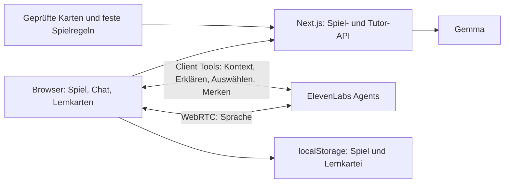

# Polyvox

## Auftrag und Rahmen

Ein gesprochenes oder per Text/Klick spielbares Lernspiel: Du gründest ein fiktives Land, gestaltest seine Institutionen und erlebst ihre Folgen. Gemma erklärt politische Konzepte, hinterfragt deine Entscheidungen und erstellt die kritische Abschlussauswertung. ElevenLabs ermöglicht den Sprachdialog.

Stand: kein bestehender Prototyp, 5½ Stunden verbleibend. Team: zwei technisch Erfahrene und zwei Hackathon-Neulinge. Ergebnis: veröffentlichte Web-App und Demo-Video. Diese Spezifikation ersetzt den bisherigen Kanzler-Simulator als Projektziel.

MVP: 7–10 Minuten Spielzeit, drei Entscheidungen mit je drei vorbereiteten Optionen, sechs Lernbegriffe und ein abschließender Nachfolgetest. Machterhalt ist ein möglicher Ausgang. Das Spiel bewertet institutionelle Folgen kritisch und trennt persönliche Macht von gesellschaftlichen Ergebnissen.

## Spiel und politischer Bildungsauftrag

Du beginnst als Gründungsfigur mit vorläufigen Befugnissen. Ob du später regierst, abgewählt werden kannst oder nur ein repräsentatives Amt behältst, ergibt sich aus deinen Institutionen. Bevölkerung, Ressourcen und demokratische Vorerfahrungen werden als fiktive Ausgangsbedingungen vorgegeben.

| Szene | Entscheidung und Konflikt | Lernanker |
|---|---|---|
| 1. Eine Verfassung entsteht | Lebenslange Alleinregierung, gewähltes Parlament oder direkte Abstimmungen: Wer legitimiert Entscheidungen, und wer darf mitentscheiden? | Gesellschaftsvertrag, Volkssouveränität; unterschiedliche Antworten von Hobbes und Locke als Ausgangspunkt |
| 2. Wohnungsnot und ein unbequemes Gericht | Ein Vorhaben wird gestoppt. Plan rechtskonform ändern, ein kontrolliertes und befristetes Sonderverfahren nutzen oder die gerichtliche Kontrolle ausschalten? | Gewaltenteilung nach Montesquieu, Rechtsstaat; Machtbegrenzung gegen schnelle Durchsetzung abwägen |
| 3. Eine unpopuläre Minderheit protestiert | Kritik zulassen und antworten, konkrete behauptete Rechtsverstöße unabhängig prüfen lassen oder Protest pauschal verbieten? | Minderheitenschutz und Meinungsfreiheit; Mehrheitswille und Grundrechte unterscheiden |

Optionen müssen zum bereits geschaffenen System passen. Hat die erste Szene kein Parlament oder unabhängiges Gericht geschaffen, beschreiben spätere Szenen den Konflikt als Forderung, solche Institutionen einzurichten. Es gibt keinen automatisch auftauchenden Gerichtshof, den niemand eingerichtet hat.

Nach jeder Entscheidung: sichtbare Folgen → kurze Theorie-Erklärung → eine kritische Rückfrage → optional „Erklären“ und „Merken“. Gemma erklärt Zusammenhänge anhand geprüfter Karten und weist auf Grenzen einer Theorie hin. Eine Option ist keine vollständige Umsetzung der Lehre eines Philosophen.

Zum Schluss der Nachfolgetest: Eine andere Person verfügt hypothetisch über dieselben geschaffenen Befugnisse. Für jeden Spielweg wird geprüft, wie Fehlentscheidungen korrigiert, Rechte geschützt und Machtwechsel ermöglicht werden. Dieser Test ist ein transparentes Gedankenexperiment; er behauptet keinen zwangsläufigen historischen Verlauf.

Die Auswertung zeigt Vorteile, Kosten und Risiken jeder institutionellen Entscheidung. Demokratische Systeme dürfen im Szenario Verzögerungen oder unbeliebte Ergebnisse erzeugen; autoritäre Maßnahmen können kurzfristig Zustimmung gewinnen. Grundrechte und unkontrollierte Macht bleiben als eigenständige Kriterien sichtbar. Kein versteckter Gesamtbonus lässt automatisch „Demokratie gewinnen“. Demokratische Werte und Menschenrechte werden als normativer Maßstab offengelegt.

## Dashboard und Daten

- Fiktive Spielwerte: Zufriedenheit, Wohnkostenindex und Staatsbudget. Keine erfundenen realen Euro-Beträge oder Prognosewahrscheinlichkeiten.
- Institutionenstatus: Grundrechtsschutz und Machtkontrolle, nachvollziehbar aus den getroffenen Regeln, etwa unabhängige Justiz, überprüfbare Befugnisse und freie Wahlen.
- Eine fiktive Sonntagsfrage ist optional und nur bei freien Wahlen und unabhängiger Erhebung sinnvoll. Andernfalls zeigt die App die fehlende Verlässlichkeit freier Zustimmungsmessung.

Historische deutsche Lebenszufriedenheit dient höchstens als separat beschrifteter Vergleich mit Quelle, Jahr und Messdefinition. Daraus folgt keine kausale Formel für den Effekt einer neuen Staatsform. Keine Datenpipeline im MVP. Theoriequellen, Modellannahmen und fiktive Spielwerte bleiben unterscheidbar.

## Infrastruktur

| Baustein | Konkrete Umsetzung |
|---|---|
| App und Hosting | Next.js, React, TypeScript und Tailwind; eine Vercel-Bereitstellung mit HTTPS |
| Spielregeln | Gemeinsames TypeScript-Modul: gültige Optionen, Institutionen, feste Effekte und verzögerte Folgen |
| Wissen | Lokale JSON-Dateien für drei Szenen, sechs Begriffskarten, Quellen und Fragen |
| Gemma | Backend ruft den Veranstalter-Endpunkt oder ein verfügbares Gemma-Modell über OpenRouter auf, z. B. google/gemma-3-27b-it |
| Sprachgespräch | ElevenLabs Agents mit @elevenlabs/react; WebRTC-Verbindung aus dem Browser |
| Zustand | Spielverlauf und Lernkartei im Browser/localStorage; Zustand bei Backend-Aufrufen mitgeben |
| Zugangsdaten | Gemma- und ElevenLabs-Schlüssel serverseitig; kurzlebiger Gesprächstoken für den Browser |

### Wichtige Modellentscheidung

Für den schnellsten Weg zum durchgehenden Gespräch nutzt ElevenLabs Agents ein zusätzliches dort unterstütztes Dialogmodell zur Gesprächs- und Werkzeugsteuerung. Alle fachlichen Spielauswertungen und Theoriefragen werden über Werkzeuge an Gemma weitergegeben. Gemma hat damit eine zentrale fachliche Aufgabe. Das zusätzliche Dialogmodell wird im Demo-Video korrekt benannt; es wird nicht als Gemma ausgegeben.

Gemma direkt als Custom LLM des Sprachagenten ist technisch über einen kompatiblen Streaming-Endpunkt möglich, erhöht aber die Integrationsarbeit. Das ist kein Pflichtbestandteil dieses 5½-Stunden-Prototyps.

### Schnittstellen und Sprachsynchronisation

- POST /api/turn: Zustand, gültige Option und Revisionsnummer entgegennehmen; Effekte berechnen; Gemma für Erklärung und Reflexion aufrufen; neuen Zustand plus strukturierte Darstellung liefern.
- POST /api/tutor: Frage, aktive Szene, relevanter Verlauf und passende Wissenskarten an Gemma senden. Rückfragen verändern keine Spielkennzahlen.
- POST /api/voice-session: Mit serverseitigem ElevenLabs-Schlüssel einen kurzlebigen Gesprächszugang für den Browser beschaffen.

Der Sprachagent erhält Client Tools für get_game_context, ask_tutor, propose_decision und remember_concept. Diese verwenden denselben aktuellen Browserzustand und dieselben App-Funktionen wie Text und Klick. ask_tutor wartet auf das Gemma-Ergebnis; der Agent nutzt dieses für seine Antwort. Optionen und Begriffe werden über feste IDs ausgewählt.

Eine vorgeschlagene Entscheidung erscheint sichtbar und wird vor dem Rundenwechsel bestätigt. Für das MVP reicht der Bestätigungsbutton; eine zweite ausdrückliche gesprochene Bestätigung kann ergänzt werden. Änderungen per Klick werden über sendContextualUpdate an den Sprachagenten gemeldet. Pro Gesprächsaktion wird der aktuelle Zustand gelesen, damit der Agent nicht mit veralteten Informationen weiterredet.

Nur die Spielregeln verändern Kennzahlen. Gemma liefert kurze strukturierte Erklärungen, Akteursreaktionen und erlaubte Begriffs-IDs. Das Backend prüft die Antwort. Laufende Rundenwechsel sperren weitere Bestätigungen; Antworten mit veralteter Revision werden nicht übernommen.

Der komplette Spielablauf funktioniert ohne Mikrofon und ohne laufende Sprachsession. Antworten bleiben als Text sichtbar. Bei Sprachfehlern bleibt der Zustand erhalten. Sitzung und gespeicherte Daten sind browsergebunden; es gibt kein Konto und keine Synchronisation zwischen Geräten.

## Lernwiederholung

Sechs kuratierte Begriffe: Gesellschaftsvertrag, Volkssouveränität, Gewaltenteilung, Rechtsstaat, Minderheitenschutz und friedlicher Machtwechsel. Meinungsfreiheit wird im Kontext erklärt.

„Merken“ speichert eine feste Begriffs-ID. Jede Karte enthält Erklärung, Quelle, eine Verständnisfrage und eine Transferfrage. Falsch beantwortete Karten erscheinen erneut; richtig beantwortete Karten erhalten längere Abstände. Im Demo-Durchlauf wird eine Karte nach einer weiteren Entscheidung wiederholt. Für spätere Besuche speichert die App nextReviewAt, etwa für den nächsten Tag, dann drei und sieben Tage später. Das ist eine einfache Wiederholungsregel, keine validierte Lernoptimierung.

Für den MVP werden Multiple-Choice-Antworten anhand hinterlegter Lösungen geprüft. Gemma erklärt Fehler. Politische Präferenzen werden nicht als richtige oder falsche Lernantwort bewertet. Ein eigener Button zeigt fällige Lernkarten auch außerhalb eines Spieldurchlaufs. Keine Erinnerungsnachrichten oder Hintergrundjobs erforderlich.

## Arbeitsteilung und Zeitplan

| Person | Aufgabe |
|---|---|
| A, erfahren | App, Spielzustand, Regelmodul, Dashboard und Deployment; unterstützt D |
| B, erfahren | Gemma-Routen, ElevenLabs-Agent, Token, Werkzeuge und Antwortprüfung; unterstützt C |
| C, erster Hackathon | Szenen und sechs Wissenskarten nach Vorlage; Spielannahmen und Quellen; zwei Wege testen |
| D, erster Hackathon | Lernkarten- und Ergebnisansicht mit Beispieldaten; Transkriptdarstellung und Demo-Video |

In den ersten 20 Minuten stellt A für D einen fertigen UI-Baustein bereit; B erstellt mit C eine vollständige Datenkarte. Gemeinsame Datenformate anschließend stabil halten.

| Zeit ab Start | Meilenstein |
|---|---|
| 0:00–0:30 | App erstmals deployed; echte Gemma-Antwort; ElevenLabs-Konto/Agent und Mikrofonverbindung getestet |
| 0:30–1:30 | Eine Szene vollständig per Text; Sprachagent ruft mindestens eine echte App-Funktion auf |
| Bei 1:30 | Falls durchgehender Sprachdialog nicht funktioniert: verbindlich auf den Sprach-Fallback wechseln |
| 1:30–3:00 | Drei Szenen, Institutionsstatus und Lernkartei fertig |
| 3:00–4:00 | Nachfolgetest, kritische Auswertung, Text/Sprach-Synchronisation und Fehlerbehandlung |
| 4:00–4:30 | Zwei Spielwege testen und ersten brauchbaren Demo-Durchlauf sichern |
| 4:30–5:30 | Funktionen einfrieren; Video aufnehmen, exportieren, prüfen und abgeben |

Fallback für Stimme: Browseraufnahme → ElevenLabs Scribe v2 → derselbe Tutor/Spiel-Backend-Pfad mit Gemma → ElevenLabs Flash v2.5 für gesprochene Antworten. Das ist ein Gespräch mit einzelnen Sprechbeiträgen; freie Unterbrechungen werden dann nicht versprochen. Text und Klick bleiben erhalten.

## Demo und Abnahme

Zielvideo 90–120 Sekunden, tatsächliche Abgaberegeln vor Ort prüfen. Zeigen: Land gründen → eine Entscheidung treffen → per Stimme nach Gewaltenteilung fragen → Begriff merken → eine Folge erleben → Lernkarte beantworten → Nachfolgetest und kritische Auswertung.

Fertig ist der Prototyp, wenn er öffentlich erreichbar ist, alle drei Szenen ohne Sprache funktionieren, mindestens ein echter Gemma-Aufruf und ein echter ElevenLabs-Sprachweg nachweisbar sind, eine gemerkte Karte wiederkehrt und die Auswertung auf den tatsächlichen Institutionen basiert. Keine Folien nötig.

## Verwendete Dokumentation und Inhaltsquellen

- [ElevenLabs React SDK: Gespräche, Token, Client Tools und Kontextupdates](https://elevenlabs.io/docs/eleven-agents/libraries/react)
- [ElevenLabs Client Tools und Warten auf Werkzeugergebnisse](https://elevenlabs.io/docs/eleven-agents/customization/tools/client-tools)
- [ElevenLabs Custom LLM: zusätzlicher Integrationsweg](https://elevenlabs.io/docs/eleven-agents/customization/llm/custom-llm)
- [ElevenLabs Speech to Text](https://elevenlabs.io/docs/api-reference/speech-to-text/convert)
- [ElevenLabs Text to Speech](https://elevenlabs.io/docs/overview/capabilities/text-to-speech)
- [Gemma 3 27B über OpenRouter](https://openrouter.ai/google/gemma-3-27b-it/api)
- [bpb: Demokratie, Menschenrechte und politische Bildung](https://www.bpb.de/kurz-knapp/taegliche-dosis-politik/582489/neutralitaetsgebot/)
- [bpb: Gesellschaftsvertrag](https://www.bpb.de/kurz-knapp/lexika/politiklexikon/296361/gesellschaftsvertrag/)
- [bpb: Gewaltenteilung](https://www.bpb.de/themen/deutsche-einheit/lange-wege-der-deutschen-einheit/501176/gewaltenteilung/)
- [Eurostat: Datensatz zur Lebenszufriedenheit](https://ec.europa.eu/eurostat/databrowser/view/ILC_PW01/default/map?lang=en)
